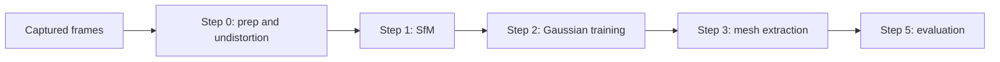
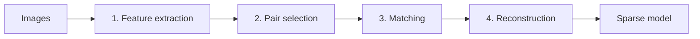
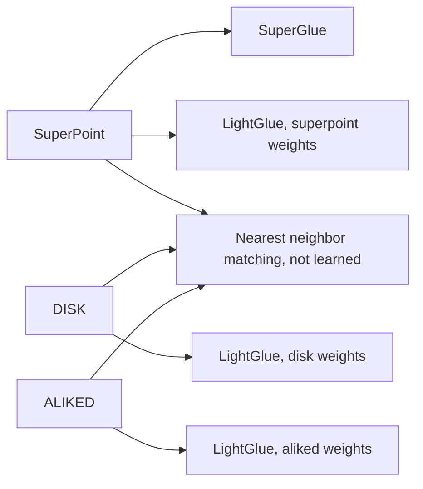
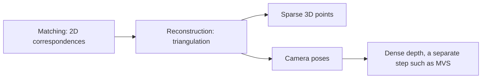
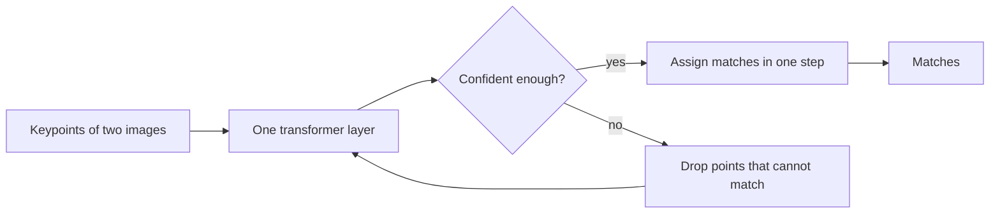
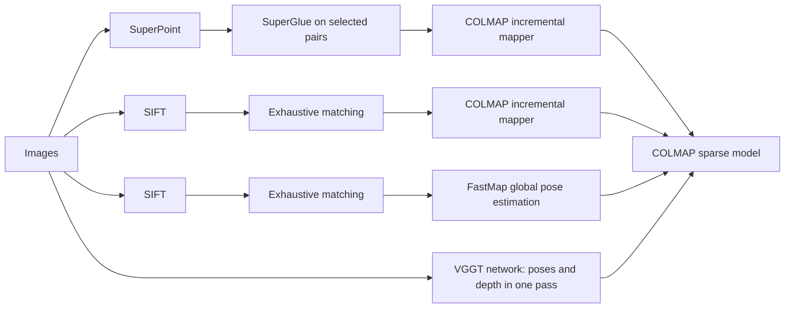

# SfM Basics and the 3DRC SfM Methods

This is an introduction to Step 1 (SfM) for readers new to it. For run commands and options, see Step 1 in [pipeline_architecture.md](pipeline_architecture.md).

## 1. Where SfM sits in the pipeline

Structure from Motion (SfM) takes only a set of photos and recovers, at the same time, the position and orientation of the camera for each photo and a sparse set of 3D points of the scene. Gaussian training takes these camera poses as given, so an error in SfM carries into every later step.

The output of Step 1 is a COLMAP sparse model (cameras.bin, images.bin, points3D.bin) in data/SCENE/sparse/METHOD/. Every later step reads only this folder, so it does not matter to them which SfM method produced it.

## 2. The four stages of hloc

hloc is the default SfM method ([src/sfm/hloc_pipeline.py](../src/sfm/hloc_pipeline.py)). Each stage writes a file and the next stage reads it, so the algorithm in one stage can be replaced without touching the others as long as the file format stays the same.

| Stage | What it does | Writes | Current choice |
| --- | --- | --- | --- |
| 1. Feature extraction | Finds distinctive points (keypoints) in each image and a vector describing each one (descriptor) | features.h5 | SuperPoint |
| 2. Pair selection | Decides which images are compared with each other | pairs-STRATEGY.txt | sequential, overlap 100 |
| 3. Matching | Finds keypoint pairs in two images that show the same physical point | matches.h5 | SuperGlue |
| 4. Reconstruction | Solves camera poses from the matches and triangulates 3D points | sfm/ | COLMAP incremental mapper |

Pair selection decides most of the run time, because matching runs once per pair. The sequential strategy pairs each frame with the next overlap frames, so 288 images give 23,750 pairs with overlap 100 and 5,550 with overlap 20. A smaller overlap can lose links between frames that are far apart in time but see the same place again; the sequential+retrieval strategy adds those back by finding similar-looking images with NetVLAD.

## 3. The feature extractor and the matcher must fit each other

A learned matcher is trained on the descriptors of a specific feature extractor, so stages 1 and 3 cannot be swapped independently.

3DRC uses SuperPoint, so switching the matcher to LightGlue keeps features.h5 and only reruns matching.

## 4. Matching is not depth estimation

Matching only finds 2D correspondences: "point (x, y) in photo A and point (x', y') in photo B are the same spot". It carries no depth.

Depth first appears in reconstruction, by triangulating matches seen from several cameras, and even then only at keypoints. A depth value for every pixel comes from a separate step after SfM, such as multi-view stereo (MVS). VGGT (section 6) is the exception: its network predicts a depth map per image directly.

## 5. SuperGlue and LightGlue

Both take the keypoints of two images and find correspondences with an attention-based network. The hloc README calls LightGlue SuperGlue's "faster follow-up". SuperGlue runs every layer for every pair and then an iterative assignment step:

LightGlue checks after each layer whether it is already confident, stops early if so, and drops points that cannot match, so it does less work on easy pairs.

## 6. The four SfM methods in 3DRC

[scripts/01_sfm_hloc.sh](../scripts/01_sfm_hloc.sh) picks one of four methods from SFM_METHOD (default hloc) or its first argument. All four write a COLMAP sparse model, so Step 2 can train on any of them.

| | hloc | sfm | fastmap | vggt |
| --- | --- | --- | --- | --- |
| Features | SuperPoint (learned) | SIFT | SIFT | none |
| Pairs | sequential, exhaustive or sequential+retrieval | all pairs | all pairs | none |
| Matching | SuperGlue (learned) | COLMAP | COLMAP | none |
| Pose estimation | Incremental: adds images one at a time with bundle adjustment | Incremental | Global: all rotations, then all translations, on GPU | Predicted by a transformer in one pass over all images |
| 3D points | Triangulated from matches | Triangulated from matches | Built from tracks | Sampled from predicted depth maps |
| Trade-off | Configurable pairs; run time grows with pair count | Matching cost grows with the square of the image count | Fast, but its README warns it is less robust with sparse coverage, poor matches or degenerate motion | No matching at all; 3DRC runs it without bundle adjustment, and all images must fit in GPU memory at once |

## 7. Glossary

| Term | Meaning |
| --- | --- |
| Keypoint | A pixel location, such as a corner or a texture detail, that is easy to find again in another photo |
| Descriptor | A vector summarizing the appearance around a keypoint. Similar spots have similar vectors |
| Pair | Two images chosen for matching |
| Correspondence (match) | Two keypoints in two images that show the same physical point |
| Track | One physical point followed across several images |
| Triangulation | Recovering a 3D position by intersecting the viewing rays of two or more cameras with known poses |
| Incremental mapper | COLMAP's approach of adding cameras one at a time and refining everything with bundle adjustment |
| Global SfM | Solving all camera rotations and then all translations at once instead of one camera at a time |
| Bundle adjustment | Jointly refining camera poses and 3D points to minimize reprojection error |
| Reprojection error | Pixel distance between a keypoint and its 3D point projected back into the image. Smaller is better |
| Depth map | An image that stores the distance from the camera for every pixel |
